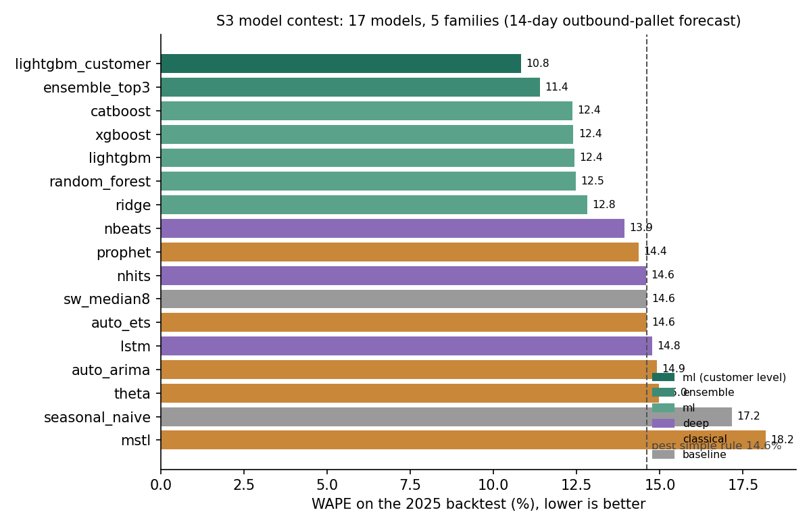

# PalletCast: End-to-End MLOps for Cold-Chain Pallet Forecasting

An end-to-end MLOps project for one real business problem at an automated cold-storage
operator: **forecast each site's outbound pallets for the next 14 days**, so dock
slots, trucks and shifts can be planned.

> All data is **simulated**: no real company data is used. The simulator also provides the
> ground truth, so every check in the pipeline can be measured, not just eyeballed.

## Results at a glance

| | |
|---|---|
| Forecast error (WAPE), 2025 backtest | **10.8%** for the deployed model vs 14.6% for the best simple rule |
| Forecast error, unseen 2026 | **10.9%** (the model chosen in 2025 also beat both challengers) |
| Data problems caught | every planted bad row and outage; corrupted months stop the pipeline |
| Leakage | none: features rebuilt from data truncated at each forecast morning are identical |
| Live problems caught | sudden customer changes detected in the **first week** by bias monitoring |
| Retraining | monthly retraining + gate kept: accuracy ~equal to never retraining (recent-history features adapt), but removes the slow drift into under-forecasting (−1.6% → −0.3%) |



## The 9 stages

| # | Stage | What it does | Tools | Write-up |
|---|---|---|---|---|
| S1 | Data | Simulated WMS feed with planted faults; validation with quarantine; versioning | pandera, DVC | [s1](docs/s1_data.md) |
| S2 | Features | Point-in-time features for every forecast morning; leakage tests | pandas | [s2](docs/s2_features.md) |
| S3 | Training | Fair contest of 17 models in 5 families + 6 experiments | LightGBM, statsforecast, Prophet, neuralforecast, MLflow | [s3](docs/s3_training.md) |
| S4 | Registry | Versioned models with lineage; promotion gate | MLflow registry | [s4–s7](docs/s4_to_s7.md) |
| S5 | Orchestration | Monthly flow: validate → features → train → gate | Prefect | [s4–s7](docs/s4_to_s7.md) |
| S6 | Serving | Forecast API, same feature code as training; container | FastAPI, Docker | [s4–s7](docs/s4_to_s7.md) |
| S7 | Monitoring | Live error, bias and drift with alerts; challenger test | Evidently | [s4–s7](docs/s4_to_s7.md) |
| S8 | Retraining | Frozen vs monthly vs alert-triggered retraining | – | [s8–s9](docs/s8_s9.md) |
| S9 | CI/CD | Lint + fast tests, pipeline tests, image build on every PR; release on tags | GitHub Actions | [s8–s9](docs/s8_s9.md) |

## Quick start

```bash
uv sync                                   # everything (core + training + dev tools)
./scripts/macos_openmp_fix.sh             # macOS without Homebrew only (LightGBM/XGBoost)

uv run dvc repro                          # S1-S2: simulate -> validate -> features
uv run python -m palletcast.models.leaderboard        # S3 (backtests: see docs/s3_training.md)
uv run python -m palletcast.registry.registry bootstrap --run-date 2025-12-01   # S4
uv run python -m palletcast.pipeline.flow --months 2026-01 2026-02 2026-03       # S5
uv run uvicorn palletcast.serving.app:app --port 8000                            # S6
uv run python -m palletcast.monitoring.monitor                                   # S7
uv run python -m palletcast.retraining.experiment                                # S8
uv run pytest -q                                                              # tests
```

Dashboards: `uv run mlflow ui --backend-store-uri sqlite:///mlflow.db` (open
http://127.0.0.1:5000; on macOS "localhost:5000" can hit AirPlay) and
`uv run prefect server start` (http://127.0.0.1:4200).

## Layout

```
configs/         every assumption and threshold (data, features, training, registry, monitoring)
src/palletcast/
  data/          S1 simulator, faults, validation
  features/      S2 point-in-time features
  models/        S3 baselines, classical, ML, deep, experiments, leaderboard
  registry/      S4 forecaster wrapper, registry + gate
  pipeline/      S5 Prefect flow
  serving/       S6 FastAPI app, model export
  monitoring/    S7 monitor
  retraining/    S8 policy experiment
tests/           data, leakage, backtest, gate, serving, monitoring tests
docs/            one write-up per stage
reports/         results (leaderboards, decisions, monitoring tables)
```

## Main lessons
1. **The data level mattered more than the algorithm.** Customer-level forecasts summed to
   sites beat every site-level model; the five ML algorithms were nearly tied.
2. **Honest evaluation needs rules fixed in advance.** A fix that looked great on test data
   lost on the tuning period and was not adopted. The simple model chosen in 2025 also won
   on 2026.
3. **Watch error and bias, not just drift.** Drift alerts were noisy and missed the most
   important change; bias caught it in a week.
4. **Retraining is mostly about bias, not speed.** Recent-history features adapt on their
   own; a model can only learn a new situation once its labels are final (3 weeks).
5. **Point-in-time correctness is about trust more than accuracy here.** It changed accuracy
   very little in this dataset, but it's what makes the backtest numbers believable.
